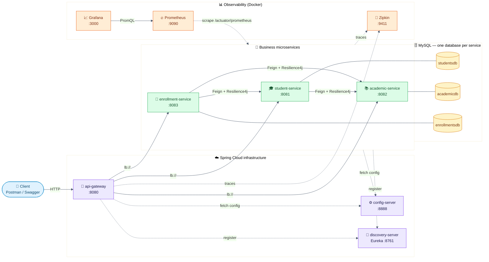

# Student Management — Architecture Microservices avec Spring Cloud

Projet de gestion d'étudiants découpé en microservices (Spring Boot 3.5, Spring Cloud 2025.0, Java 17), réalisé dans le cadre du DS *Architecture des composants* (GL5, FST).

## Sommaire

1. [Architecture](#architecture)
2. [Structure du dépôt](#structure-du-dépôt)
3. [Prérequis](#prérequis)
4. [Configuration (.env)](#configuration-env)
5. [Démarrage](#démarrage)
6. [API](#api)
7. [Résilience (Resilience4j)](#résilience-resilience4j)
8. [Surveillance (Actuator, Prometheus, Grafana)](#surveillance-actuator-prometheus-grafana)
9. [Traçabilité (Zipkin)](#traçabilité-zipkin)
10. [CQRS avec Axon](#cqrs-avec-axon-enrollment-service)
11. [Tester l'équilibrage de charge](#tester-léquilibrage-de-charge)
12. [Avancement](#avancement)

## Architecture



> Source du diagramme : [docs/architecture/architecture.mmd](docs/architecture/architecture.mmd) (affiché automatiquement par GitHub).

| Module | Rôle | Port |
| --- | --- | --- |
| `config-server` | Spring Cloud Config Server (profil `native`) | 8888 |
| `discovery-server` | Eureka : découverte et enregistrement des services | 8761 |
| `api-gateway` | Spring Cloud Gateway : point d'entrée unique, routes `lb://` | 8080 |
| `student-service` | Gestion des étudiants (valide `departmentId`) | 8081 |
| `academic-service` | Gestion des départements et des cours | 8082 |
| `enrollment-service` | Gestion des inscriptions (valide `studentId` et `courseId`) | 8083 |

Principes :
- **Une base MySQL indépendante par service** (`studentsdb`, `academicdb`, `enrollmentsdb`).
- **Communication synchrone** entre services via **OpenFeign**, avec résolution des noms par Eureka et équilibrage par **Spring Cloud LoadBalancer**.
- **Configuration centralisée** : chaque service ne contient que son nom et l'adresse du Config Server.

## Structure du dépôt

```text
pom.xml                         POM parent (modules)
.env / .env.example             variables (base de données, mot de passe)
docker-compose.yml              Axon Server + Zipkin + Prometheus + Grafana
monitoring/                     prometheus.yml, provisioning et dashboard Grafana
config-server/
  src/main/resources/
    application.yml             config du serveur (charge le .env)
    configurations/             configs servies aux clients
      application.yml           partagé (Actuator, timeouts Feign)
      student-service.yml
      academic-service.yml
      enrollment-service.yml
      api-gateway.yml
discovery-server/
api-gateway/
student-service/
academic-service/
enrollment-service/
```

## Prérequis

- Java 17
- MySQL sur `localhost:3306`
- Docker (pour Axon Server, Zipkin, Prometheus et Grafana)

## Configuration (.env)

Copier le modèle puis adapter les valeurs :

```powershell
Copy-Item .env.example .env
```

| Variable | Rôle | Défaut |
| --- | --- | --- |
| `DB_HOST` | hôte MySQL | `localhost` |
| `DB_USER` | utilisateur MySQL | `root` |
| `DB_PASSWORD` | mot de passe MySQL | *(obligatoire)* |
| `STUDENT_DB` | base de `student-service` | `studentsdb` |
| `ACADEMIC_DB` | base de `academic-service` | `academicdb` |
| `ENROLLMENT_DB` | base de `enrollment-service` | `enrollmentsdb` |
| `GRAFANA_PASSWORD` | mot de passe admin Grafana (optionnel) | `admin` |

Le fichier `.env` est ignoré par Git. Il est lu par le **Config Server**, qui renvoie aux services les valeurs déjà résolues : lance donc le Config Server **depuis la racine du projet**. Les bases sont créées automatiquement si le compte MySQL en a le droit.

## Démarrage

Chaque commande dans son propre terminal, depuis la racine. **L'ordre compte** : Config Server → Eureka → services → Gateway.

```powershell
.\mvnw.cmd -pl config-server spring-boot:run
.\mvnw.cmd -pl discovery-server spring-boot:run
.\mvnw.cmd -pl student-service spring-boot:run
.\mvnw.cmd -pl academic-service spring-boot:run
.\mvnw.cmd -pl enrollment-service spring-boot:run
.\mvnw.cmd -pl api-gateway spring-boot:run
```

Puis la supervision :

```powershell
docker compose up -d
```

Vérifications :

| Quoi | URL |
| --- | --- |
| Config servie à un service | http://localhost:8888/student-service/default |
| Tableau Eureka | http://localhost:8761 |
| Swagger étudiants | http://localhost:8081/docs |
| Swagger académique | http://localhost:8082/docs |
| Swagger inscriptions | http://localhost:8083/docs |

Pour construire tous les JAR : `.\mvnw.cmd package` (ajouter `-DskipTests` pour aller plus vite).

## API

Tout passe par la Gateway (`http://localhost:8080`) :

| Ressource | URL |
| --- | --- |
| Étudiants | `/students` |
| Départements | `/departments` |
| Cours | `/courses` |
| Inscriptions | `/enrollments` |

Chaque ressource expose `GET /`, `GET /{id}`, `POST /`, `PUT /{id}`, `DELETE /{id}`.

Exemple de création d'inscription (`POST /enrollments`) :

```json
{
  "enrollmentDate": "2026-11-17",
  "grade": null,
  "status": "ACTIVE",
  "studentId": 1,
  "courseId": 1
}
```

Codes retournés lors de la validation des références : `422` si l'étudiant, le cours ou le département n'existe pas, `503` si le service distant est indisponible.

## Résilience (Resilience4j)

Les appels Feign sont protégés dans `RemoteLookupService` (enrollment) et `DepartmentLookupService` (student). Configuration dans `config-server/.../configurations/*-service.yml` :

| Mécanisme | Paramètres |
| --- | --- |
| **Retry** | 3 tentatives, 500 ms entre chaque |
| **Rate Limiter** | 5 requêtes / seconde |
| **Circuit Breaker** | fenêtre de 10 appels, ouverture à 50 % d'échecs (min. 5 appels), 10 s en état ouvert |
| **Timeout** | connexion 2 s, lecture 5 s (Feign) |
| **Fallback** | réponse `503` explicite une fois les tentatives épuisées ou le circuit ouvert |

Ordre d'application : `Retry( CircuitBreaker( RateLimiter( appel ) ) )`, le fallback étant porté par le Retry. Les réponses `4xx` sont des réponses métier : elles ne sont ni rejouées ni comptées comme échecs.

| Défaillance | Comportement |
| --- | --- |
| Service inactif / hors ligne | exception Feign → retry → fallback `503` |
| Latence > 5 s | `read-timeout` → retry → fallback `503` |
| Réponse incorrecte (vide, id différent) | `InvalidRemoteResponseException` → comptée comme échec |
| Erreur réseau (mauvaise URL) | exception Feign → retry → fallback `503` |
| Dépendance indisponible | circuit ouvert → fallback `503` immédiat |

Scénario de démonstration : arrêter `student-service`, puis envoyer plusieurs `POST /enrollments`. Les premières requêtes échouent après ~1,5 s (3 tentatives), puis le circuit passe à `OPEN` et la réponse devient immédiate. État visible sur http://localhost:8083/actuator/circuitbreakers.

## Surveillance (Actuator, Prometheus, Grafana)

- Chaque service expose `/actuator/health`, `/actuator/metrics`, `/actuator/prometheus`, `/actuator/circuitbreakers`, `/actuator/retries`, `/actuator/ratelimiters`.
- **Prometheus** : http://localhost:9090 (cibles : http://localhost:9090/targets). Il interroge les services de la machine hôte via `host.docker.internal`.
- **Grafana** : http://localhost:3000 (`admin` / `admin` par défaut). La source de données et le dashboard *Microservices - Resilience & Metrics* sont provisionnés automatiquement : disponibilité, débit HTTP, état du circuit breaker, retries, rate limiter, mémoire JVM, latence p95.

## Traçabilité (Zipkin)

- Dépendances : `micrometer-tracing-bridge-brave`, `zipkin-reporter-brave` et `feign-micrometer` (propagation du trace id dans les appels Feign).
- Échantillonnage à 100 % et endpoint `http://localhost:9411/api/v2/spans` (variable `ZIPKIN_URL`), dans `configurations/application.yml`.
- Les logs affichent `[nom-du-service,traceId,spanId]`.
- Interface : http://localhost:9411 (démarrée par `docker compose up -d`).

Démonstration : un `POST /enrollments` via la Gateway produit une trace unique `api-gateway` → `enrollment-service` → `student-service` / `academic-service`.

## CQRS avec Axon (enrollment-service)

Le module `enrollment-service` applique CQRS + Event Sourcing avec **Axon Framework 4** :

```text
POST/PUT/DELETE → EnrollmentCommandController → CommandGateway → EnrollmentAggregate → événements (Axon Server)
                                                                                         │
GET → EnrollmentQueryController → QueryGateway → EnrollmentProjection (@QueryHandler) ◄── @EventHandler → MySQL (enrollment_view)
```

| Élément | Classe |
| --- | --- |
| Commandes | `CreateEnrollmentCommand`, `UpdateEnrollmentCommand`, `DeleteEnrollmentCommand` |
| Événements | `EnrollmentCreatedEvent`, `EnrollmentUpdatedEvent`, `EnrollmentDeletedEvent` |
| Aggregate (logique métier) | `EnrollmentAggregate` (`@CommandHandler`, `@EventSourcingHandler`) |
| Modèle de lecture | `EnrollmentView` (table MySQL `enrollment_view`) |
| Projecteur | `EnrollmentProjection` (`@EventHandler` + `@QueryHandler`) |
| Requêtes | `FindAllEnrollmentsQuery`, `FindEnrollmentByIdQuery` |

- **Axon Server** (conteneur Docker) stocke les événements : console http://localhost:8024, gRPC sur le port 8124.
- **MySQL** (`enrollmentsdb`) contient le modèle de lecture.
- Le projecteur est en mode *subscribing* : le GET qui suit un POST voit déjà le résultat.
- L'API REST reste `/enrollments` via la Gateway ; l'identifiant est désormais un UUID (chaîne).
- Règles métier : étudiant et cours obligatoires et vérifiés à distance (Resilience4j), note entre 0 et 20, `409` si l'étudiant est déjà inscrit (ACTIVE) au cours.
- Tests de l'aggregate : `.mvnw.cmd -pl enrollment-service test`.

## Tester l'équilibrage de charge

Lancer une seconde instance d'un service sur un autre port :

```powershell
$env:STUDENT_PORT=8091; .\mvnw.cmd -pl student-service spring-boot:run
```

Les deux instances apparaissent dans Eureka sous `STUDENT-SERVICE`. Les requêtes passant par la Gateway (`/students`) ou par Feign sont réparties entre elles (round-robin) ; les logs de chaque instance permettent de le constater.

## Avancement

- [x] Config Server
- [x] Eureka, API Gateway, microservices, base par service, Swagger
- [x] OpenFeign + Spring Cloud LoadBalancer
- [x] Resilience4j (retry, rate limiter, circuit breaker, fallback)
- [x] Actuator, Micrometer, Prometheus, Grafana
- [x] Zipkin (traçabilité)
- [x] CQRS avec Axon Framework et Axon Server (Docker)
- [ ] Collection Postman
